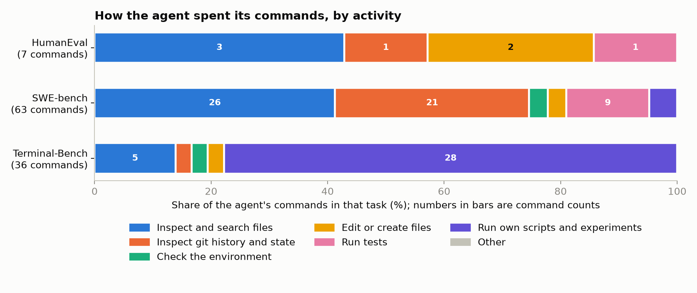
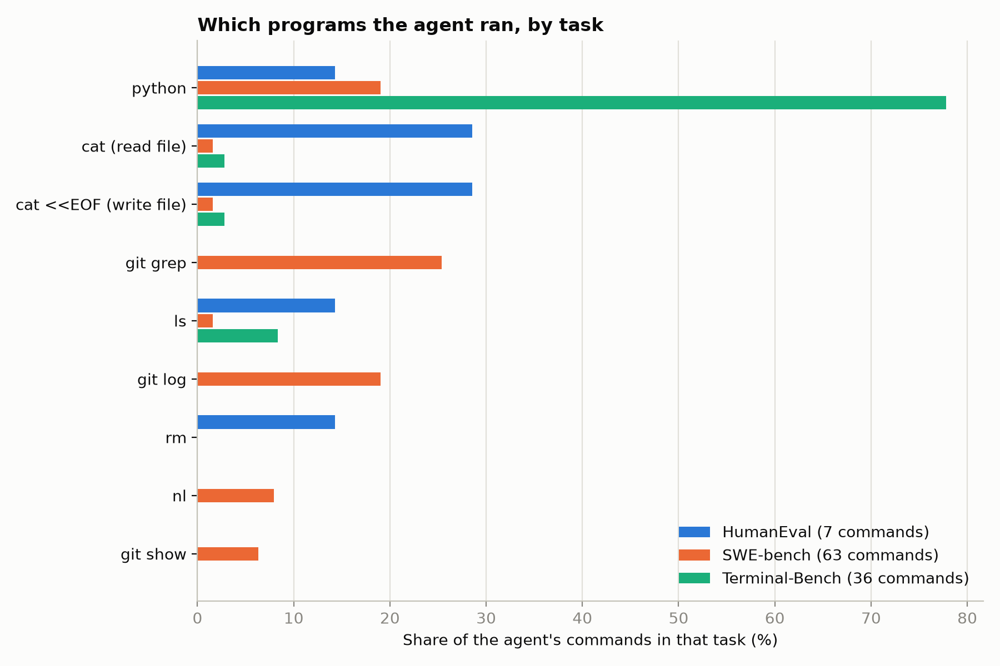
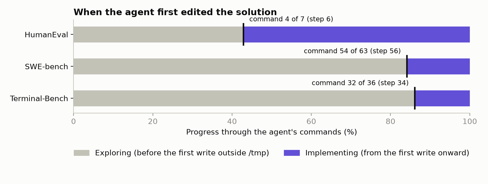

# Section 3: Run Example Tasks

## 3.1 Task 1: HumanEval

**Problem 3 (`run-example-task`)**

1. Which files are available to the agent while it works, and which files become available only during verification? Why does this separation matter?

   While working, the agent has access to the task description in `instruction.md` and the files the `Dockerfile` puts in the container, which here is `humaneval_0.py`. During verification, the `tests/` folder (`test.sh` and `test_outputs.py`) becomes available. This separation matters because if the agent could see the tests, it could copy the expected answers instead of solving the task, and the reward would mean nothing.

2. Run `uv run harbor run --help`. Name two agent scaffolds other than `oracle` and two environment backends other than Docker. What distinct role does each category play?

   Two agent scaffolds are `mini-swe-agent` and `claude-code`. Two environment backends are `daytona` and `modal`. The scaffold is the program around the model that sends prompts, runs the model's commands, and returns the results, so it decides how the agent works. The environment backend is where the task's container runs, so it decides where the agent works.

3. Trace the verification process after the agent finishes: which file does Harbor execute, where do the private tests come from, and how is the final reward communicated back to Harbor?

   Harbor executes `tests/test.sh`. The private tests come from the task's `tests/` folder, which Harbor copies into the container only after the agent finishes. The final reward is communicated by `test.sh` writing it to a reward file, which Harbor reads; in my run, `verifier/reward.txt` contained `1`.

**Problem 4 (`run-example-agent`)**

1. Summarize the agent's approach. Which files and commands did it use?

   The agent read the starter file with `cat /app/humaneval_0.py` (step 3) and listed the folder with `ls -la /app` (step 4). It wrote its own test script at `/tmp/test_has_close_elements.py` (step 5). It then overwrote `/app/humaneval_0.py` with a solution that sorts the list and compares each pair of neighbors (step 6). It checked the solution with `python3 -m doctest` and its test script (step 7), then submitted with `echo COMPLETE_TASK_AND_SUBMIT_FINAL_OUTPUT` (step 10).

2. Identify one decision in the trajectory that helped or hurt the final result. Cite the relevant step.

   In step 5 the agent decided to write its own tests, including edge cases like an empty list, a single number, and two equal numbers with threshold 0. This helped because in step 7 it could confirm that its solution passed all of them and both docstring examples before submitting.

3. Did the verifier reward accurately reflect the quality of the agent's solution? Why or why not?

   Yes. The reward was 1.0 and the solution is correct. After sorting, the two closest numbers are always next to each other, so checking neighbors is enough to find any pair closer than the threshold. The agent also confirmed this with its own tests in step 7.

## 3.2 Task 2: SWE-bench Verified

**Problem 5 (`run-swebench-agent`)**

1. Summarize the agent's approach. How did it locate the relevant code, and what change did it make?

   The agent located the code with `find . -name "validators.py" | grep auth` (step 3) and read `django/contrib/auth/validators.py` (step 4). It changed the regex in both `ASCIIUsernameValidator` and `UnicodeUsernameValidator` from `r'^[\w.@+-]+$'` to `r'\A[\w.@+-]+\Z'` (step 56). It then ran the auth tests to confirm the fix (steps 60 and 61).

2. Identify one point where the agent used repository context that would not exist in a self-contained HumanEval task.

   In steps 18 to 20 the agent used the git history. `git show 014247ad` showed an earlier Django fix that replaced `$` with `\Z` in other validators for the same newline problem. A HumanEval task is a single function with no history or other code to look at.

3. Compare this trajectory with the HumanEval trajectory. What made this task more difficult to understand, modify, or verify?

   The HumanEval run took 8 agent steps on one file, while this one took 64. Here the agent had to find the right file in the whole Django repository from a bug report. Verifying was also harder: it needed three attempts to run the tests (steps 7, 9, and 12) and had to run the full `auth_tests` suite to check nothing else broke.

4. Did the final reward accurately reflect the quality of the agent's solution? Support your answer with evidence from the verifier logs.

   Yes. The reward was 1.0 and the agent made the change the issue asked for. The verifier log shows `test_ascii_validator ... ok` and `test_unicode_validator ... ok`, then `Ran 22 tests ... OK` and `SWEBench results ... PASSED`.

## 3.3 Task 3: Terminal-Bench 2.1

**Problem 6 (`run-terminal-bench-agent`)**

1. Summarize the agent's approach. What information did it gather, and what solution strategy did it pursue?

   The agent listed `/app`, read `/app/forward.py`, and checked the shape of `A1` (steps 3, 4, and 10). Its strategy was to find kinks along random lines, where one ReLU neuron switches on or off, and use the change in gradient at each kink to recover that neuron's row of `A1` up to scaling (step 15). It repeated this over many lines (step 25) and wrote the method into `/app/steal.py`, which saves `/app/stolen_A1.npy` (step 34).

2. Identify one point where the agent made meaningful progress and one point where its approach broke down or became unproductive.

   It made meaningful progress in step 15, where the gradient difference at a kink matched the true row of `A1` with cosine similarity 1.0. Its approach broke down in steps 36 to 38, where it only checked its result against the local 20-neuron network and then submitted. The verifier used a 30-neuron network and `steal.py` missed one row, so the task failed.

3. What evidence does the verifier provide beyond the scalar reward? Does it capture partial progress on this task?

   The verifier log shows the failed assertion: `Failed to match rows: [22]`. This means 29 of the 30 rows were recovered and only row 22 was missed. The log captures this partial progress, but the reward does not, since it is 0.0 either way.

4. How did the open-ended terminal environment affect the agent's ability to plan, test its assumptions, and recover from mistakes?

   The terminal let the agent test each assumption with a short script before building on it, such as the kink formula in step 13. It also let it recover from mistakes: when `scipy` was missing in step 17, it switched to numpy in step 18. But the terminal did not show what the hidden test would use, so the agent's own checks passed and it still failed.

## 3.4 Analyzing Agent Trajectories

**Problem 7 (`analyze-trajectories`)**

Answer **three** of the seven questions below and **delete the other four**. For each question you answer, save the figure as a PNG in `writeup/3_run_example_tasks/` using the filename shown, then explain in 2–3 sentences what you measured, how you computed it, and what you conclude.

### `effort-distribution.png`

How did the agent distribute its effort across activities such as inspecting files, editing code, running tests, and debugging?

This figure measures how the agent split its effort across activities. Each command was assigned to one activity by rule (inspecting files, inspecting git, checking the environment, editing files, running tests, or running its own scripts), and I plotted each activity's share of the task's commands. On SWE-bench, 75% of commands were inspection (47 of 63) and only 2 edited files, so the work was finding and understanding code rather than writing it. On Terminal-Bench, 78% of commands were the agent's own experiments and none ran a test suite, because the task gave it no tests to run.

### `bash-command-usage.png`

`mini-SWE-agent` performs its work through `execute_bash`. What command-line programs and command patterns did it use across the three trajectories, and how did their use vary by task?

This figure measures which programs the agent ran in each task. For every command, I took the first program it calls and computed its share of that task's commands (7 for HumanEval, 63 for SWE-bench, 36 for Terminal-Bench). The tools changed with the task: HumanEval was mostly `cat` to read and write one file (4 of 7 commands), SWE-bench relied on `git grep` and `git log` (28 of 63), and Terminal-Bench was almost all `python` (28 of 36, or 78%).

### `exploration-to-implementation.png`

At what points did each agent appear to transition from exploring the task to implementing a solution? Define how your visualization identifies that transition.

This figure measures when each agent moved from exploring to implementing. I defined the transition as the first command that writes a file outside `/tmp`, and plotted its position as a percentage of the run. HumanEval switched early, at command 4 of 7 (43%), while SWE-bench and Terminal-Bench switched late, at command 54 of 63 (84%) and command 32 of 36 (86%). For Terminal-Bench this definition understates implementation, because the agent developed its algorithm in throwaway `python -c` commands from step 13 before saving `steal.py` at step 34.
